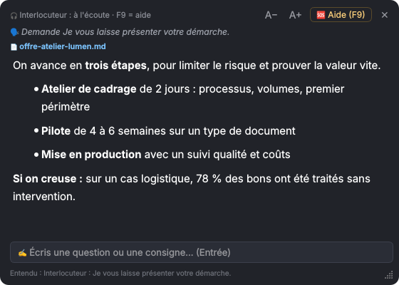
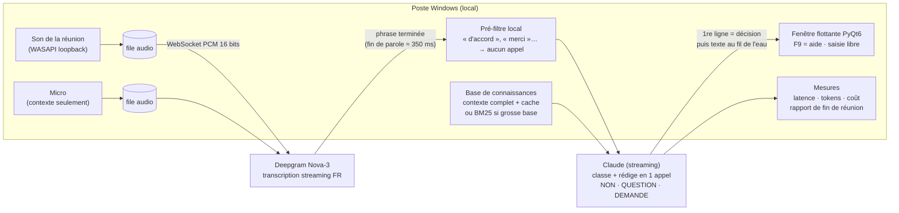

# Meeting Copilot — un copilote de réunion temps réel, mesuré et auditable

**Il écoute la réunion, repère ce qu'on attend de vous et affiche en quelques secondes une réponse claire, sourcée dans vos documents.**
Pensé pour les rendez-vous commerciaux et les réunions d'équipe : vous restez concentré sur l'échange, pas sur la recherche d'information.

> 🎬 **Démo** : _emplacement pour la vidéo / le GIF (30 s, rendez-vous commercial fictif)_
>
> 

[](../../actions/workflows/ci.yml)
· Python 3.11 · Windows · Claude (Anthropic) · Deepgram · PyQt6 · licence MIT

---

## Le problème

En rendez-vous client, les questions précises tombent au pire moment : « Où sont hébergées les données ? », « Combien coûte l'atelier ? », « Vous avez un exemple dans notre secteur ? ». L'information existe, dans une offre, une FAQ ou une étude de cas, mais la chercher pendant que le client parle casse l'échange, et répondre de mémoire expose à l'approximation.

Les outils de prise de notes existants résument **après** la réunion. Ce projet agit **pendant** :

- il détecte en continu ce qu'on attend de vous : une question précise (« combien de temps ? ») ou une demande ouverte (« présentez-nous votre démarche ») ;
- il affiche une réponse prête à dire, en indiquant d'où elle vient (📄 document, 🧭 contexte de réunion, 💡 connaissances générales) ;
- il refuse d'inventer : un prix, un délai ou une référence client absents des documents devient `[à compléter]`.

## Comment ça marche



Une phrase passe par ces étapes :

1. **Capture** : le son de sortie du PC (la voix des interlocuteurs dans Teams, Zoom ou Meet) est capté en *loopback*. Il n'y a pas de bot qui rejoint la réunion.
2. **Transcription** : Deepgram renvoie des segments en streaming. Ils sont regroupés en phrase complète quand la personne s'arrête de parler.
3. **Pré-filtre** : les phrases sans enjeu (« d'accord, merci ») sont écartées localement, sans appel à l'API.
4. **Décision et rédaction en un seul appel** : le modèle écrit d'abord un en-tête lisible par la machine (`NON`, `QUESTION | source` ou `DEMANDE | source`), puis la réponse. L'application lit l'en-tête au fil du streaming, n'affiche rien si c'est `NON`, et sinon affiche le texte au fur et à mesure.
5. **Concurrence** : si une nouvelle question arrive pendant qu'une réponse s'écrit, la plus récente prend la fenêtre et l'ancienne est interrompue (et comptée comme « remplacée »).

## Choix techniques et compromis

| Décision | Pourquoi | Ce que ça coûte |
|---|---|---|
| **Un seul appel LLM pour classer et rédiger**, avec un en-tête en 1re ligne | Deux appels (classifieur puis rédacteur) ajoutent un aller-retour réseau à chaque question. Ici, la décision arrive avec les premiers tokens. | Le format doit être robuste : un en-tête manquant ne doit jamais faire perdre une réponse (voir le bug « Non » plus bas). |
| **Claude Haiku par défaut**, Sonnet en option | La latence au premier mot compte plus que la finesse de la formulation. Haiku est le plus rapide et le moins cher. | Réponses un peu moins riches ; Sonnet se règle dans `config.toml`. |
| **Contexte complet + prompt caching plutôt que RAG vectoriel** pour une petite base | Avec quelques documents de préparation, tout envoyer donne de meilleures réponses qu'une recherche qui peut rater le bon passage. Le cache rend la relecture des documents environ 10 fois moins chère. | Ça ne passe pas à l'échelle : au-delà d'un budget (60 000 caractères par défaut), bascule automatique sur la recherche. Le cache ne s'active qu'au-delà d'une taille minimale de prompt. |
| **BM25 (lexical, pur Python) au-delà de ce budget** | Aucune dépendance ni modèle d'embedding, explicable en une phrase, testable. | Sensible aux reformulations : c'est le premier point de la roadmap. |
| **Deepgram en streaming** plutôt que Whisper local | Latence sous la seconde en français, sans GPU, sur un PC de bureau. | L'audio sort du poste, et la transcription est le premier poste de coût (voir plus bas). |
| **Capture loopback** plutôt qu'un bot de réunion | Aucun participant ajouté, compatible avec toutes les visios, gratuit. | Windows uniquement, et pas de séparation des voix des interlocuteurs. |
| **Le micro de l'utilisateur sert de contexte, pas de déclencheur** | Le copilote sait ce que vous avez déjà dit et ne le répète pas, sans se répondre à lui-même. | Le micro double le coût de transcription (désactivable). |
| **Logique découplée de l'interface et de l'audio** (`Assistant` + interface `Display`) | Toute la logique se teste avec un faux client, sans Windows, sans micro, sans API. | Un peu plus de structure qu'un script unique. |

## Un bug instructif

Dans une première version, la règle était : « si la réponse du modèle commence par `NON`, ne rien afficher ». Toute réponse légitime commençant par « Non, nous ne livrons pas le week-end… » disparaissait donc sans laisser de trace : ni erreur, ni log.

La correction tient en trois principes, maintenant couverts par des tests de régression (`tests/test_detection.py`, `tests/test_assistant.py`) :

- la décision se lit sur une **ligne d'en-tête complète** (`NON` seul sur sa ligne), pas sur un préfixe ;
- une sortie qui ne respecte pas le format est **affichée plutôt que jetée** ;
- chaque appel est **compté avec son issue** (`NON`, `QUESTION`, `DEMANDE`, `remplacée`, `erreur`) : un taux anormal de `NON` devient visible dans le rapport de réunion.

## Résultats

Les chiffres ci-dessous viennent des outils du dépôt, pas d'une estimation à la main.

| Mesure | Valeur | Comment la reproduire |
|---|---|---|
| Détection « faut-il répondre ? » (précision / rappel) | _à mesurer_ | `python -m eval.run_detection_eval` |
| Exactitude à 3 classes (NON / QUESTION / DEMANDE) | _à mesurer_ | idem, résultats dans `eval/results/` |
| Latence au premier mot affiché (p50 / p90) | _à mesurer_ | rapport de fin de réunion (`reports/`) |
| Coût réel par heure de réunion | _à mesurer_ | rapport de fin de réunion |
| Tests automatisés | 53 tests, sans appel réseau | `pytest` (exécutés en CI) |

**Ordre de grandeur du coût (estimation, pas une mesure)**, avec les tarifs de `config.example.toml` : un appel Haiku coûte environ 0,0002 $ grâce au cache, soit quelques centimes par heure même avec 200 appels. La transcription coûte environ 0,46 $ par heure et par flux audio. **La transcription représente donc plus de 90 % du coût**, et c'est elle qu'il faut optimiser en premier, pas le LLM.

**Ce que mesure la latence** : depuis la réception de la phrase finale transcrite jusqu'au premier mot affiché, puis jusqu'à la réponse complète. Elle n'inclut pas le temps de silence qui marque la fin de la phrase (`endpointing_ms`, 350 ms par défaut) ni la finalisation de la transcription.

## Installation et lancement

Prérequis : Windows 10 ou 11, Python 3.11 ou plus récent, une clé [Anthropic](https://console.anthropic.com) et une clé [Deepgram](https://console.deepgram.com).

```bat
git clone https://github.com/OWNER/meeting-copilot.git
cd meeting-copilot
scripts\install.bat        :: installe les dépendances et crée .env
notepad .env               :: colle tes deux clés
scripts\run.bat            :: ou : python -m meeting_copilot
```

La démo fonctionne telle quelle : une agence fictive (« Atelier Lumen ») présente son offre à un prospect fictif. Pour tes propres réunions :

1. copie `config.example.toml` en `config.toml` (non versionné) ;
2. fais pointer `docs_dir` et `context_file` vers tes documents et ton contexte de réunion (qui tu es, les interlocuteurs, l'objectif, le ton, les points sensibles) ;
3. relance.

**Utilisation** : la fenêtre se déplace à la souris et s'agrandit par le coin en bas à droite. **F9** (ou 🆘) demande une aide sur les derniers échanges. Le champ en bas accepte une question ou une consigne (« plus court », « reformule pour un client non technique »). À la fermeture, un rapport (latence, tokens, coût) est écrit dans `%LOCALAPPDATA%\meeting-copilot\reports`.

**Développement** (toutes plateformes) :

```bash
pip install -r requirements-dev.txt
pytest          # logique complète, faux client, aucun appel réseau
ruff check .
```

## Structure

```
meeting_copilot/
  app.py            assemblage : threads Qt + asyncio
  audio.py          capture WASAPI (loopback + micro)
  transcription.py  WebSocket Deepgram, reconnexion progressive, comptage de l'audio
  detection.py      prompts, pré-filtre, lecture de l'en-tête (module pur, très testé)
  knowledge.py      chargement des documents, découpage, BM25, choix contexte complet / recherche
  assistant.py      orchestration : appels en streaming, concurrence, mesures
  metrics.py        latences, tokens, coût, rapport JSON + Markdown
  ui.py             fenêtre PyQt6 (interface Display)
  config.py         configuration typée (config.toml), secrets via variables d'environnement
eval/               jeu de 48 phrases annotées + script d'évaluation
tests/              53 tests pytest
demo/               contexte et documents fictifs
```

## Usage responsable

- **Prévenez les participants** que la réunion est transcrite. Le rappel s'affiche au démarrage. En Europe, le RGPD s'applique à la voix des autres.
- **Les données de réunion restent sur le poste** : les journaux et les rapports sont écrits en local et ne sont jamais versionnés (`.gitignore`). L'audio et le texte transitent en revanche par Deepgram et Anthropic : vérifiez que c'est compatible avec la politique de votre organisation avant d'y mettre des documents internes.
- **Le copilote propose, l'humain décide** : la source de chaque réponse est affichée, et les faits absents des documents sont marqués `[à compléter]` plutôt qu'inventés.
- Il est conçu pour vos réunions de travail et vos rendez-vous commerciaux. Il n'est pas fait pour les situations où l'on évalue vos propres réponses (entretiens, examens).

## Limites connues

- **Windows uniquement** pour la capture audio (WASAPI loopback). La logique, elle, est multiplateforme.
- **Pas de séparation des voix** : tous les interlocuteurs sont regroupés sous « Interlocuteur ».
- **Écho** : avec des haut-parleurs, le micro capte aussi la réunion. Il faut un casque.
- **Détection imparfaite** : les phrases ambiguës (« on est prêts ? je me pose la question ») peuvent déclencher une réponse inutile, ou l'inverse. F9 sert de rattrapage manuel.
- **Recherche lexicale** au-delà de la petite base : sensible aux reformulations.
- **Le jeu d'évaluation est construit à la main** (48 phrases fictives) : il mesure des régressions, pas la performance sur de vraies réunions.

## Roadmap

- [ ] Mode **rejeu** : faire passer une transcription enregistrée dans le pipeline pour mesurer sans réunion réelle
- [ ] Recherche **sémantique** (embeddings) en complément de BM25, évaluée sur le même jeu
- [ ] Option de **transcription locale** (Whisper) pour les contextes où l'audio ne doit pas quitter le poste
- [ ] **Séparation des voix** des interlocuteurs
- [ ] Mode **entraînement** : le copilote joue le prospect et fait des retours sur vos réponses
- [ ] Paquet **.exe** à double-cliquer (PyInstaller)

## Licence

MIT. Les entreprises, personnes et chiffres des documents de démo sont fictifs.
